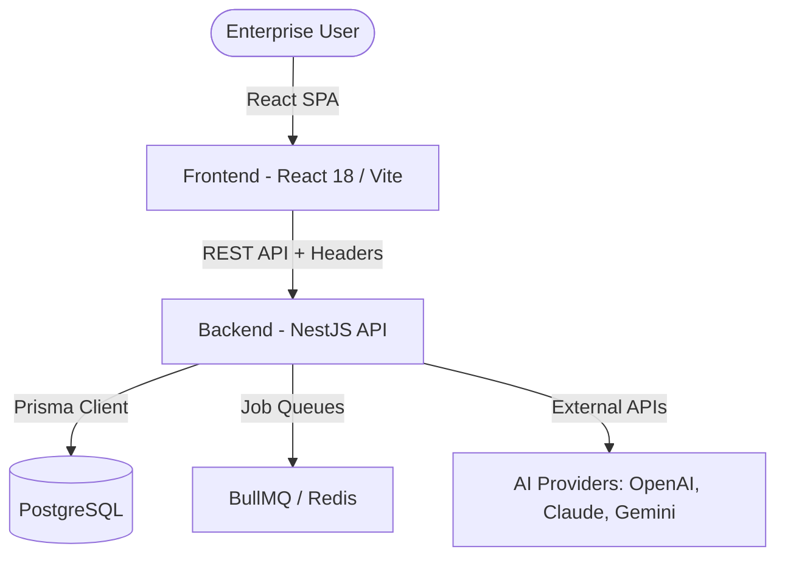

# Dyvin AI — Enterprise AI Visibility Operating System (AEO / GEO Intelligence)

[](https://github.com/dyvin-ai/dyvin-ai-platform/actions/workflows/backend.yml)
[](https://github.com/dyvin-ai/dyvin-ai-platform/actions/workflows/frontend.yml)
[](LICENSE)

Dyvin AI is the premier AI Visibility Operating System for modern enterprises, engineered for Answer Engine Optimization (AEO) and Generative Engine Optimization (GEO). It delivers continuous search visibility intelligence, cross-engine citation monitoring, competitor brand sentiment analytics, and autonomous optimization workflows across generative AI search systems (OpenAI ChatGPT, Google Gemini, Anthropic Claude, and Perplexity AI).

---

## 🏗️ System Architecture



---

## 🗄️ Monorepo Structure

The repository is structured as a pnpm monorepo workspace for clean separation of concerns and rapid package dependency resolution.

```
dyvin-ai/
├── backend/          # NestJS API, Prisma ORM, BullMQ Queues, Redis
├── frontend/         # React 18, TypeScript, Vite, Tailwind CSS, Zustand, React Query
├── shared/           # Reusable TypeScript typings, schemas, and utilities
├── docs/             # Organized Architecture & Walkthrough Documentation
├── docker/           # Development & Production Docker configurations
└── .github/          # CI/CD Workflows, issue/PR templates
```

---

## 🛠️ Tech Stack

### Backend
- **Framework**: NestJS (TypeScript)
- **Database**: PostgreSQL with Prisma ORM
- **Caches & Queues**: Redis & BullMQ
- **Validation**: `class-validator` & `zod`

### Frontend
- **Framework**: React 18 with TypeScript & Vite
- **Styling**: Tailwind CSS & Framer Motion
- **State Management**: Zustand & React Query (TanStack Query)
- **Routing & Guards**: React Router with hierarchical RBAC guards

---

## 🚀 Setup & Local Development

### Prerequisites
- Node.js (v20+)
- pnpm (v9+)
- Docker & Docker Compose (optional)

### 1. Environment Configuration
Copy environment files for both apps:
```bash
# Root
cp .env.example .env

# Backend
cp backend/.env.example backend/.env
```

### 2. Dependency Installation
Install dependencies across the monorepo:
```bash
pnpm install
```

### 3. Database Migration
Spawn database via Docker Compose and run Prisma migrations:
```bash
# Start Docker services (Postgres, Redis)
docker compose up -d

# Run migrations & generate Prisma client
pnpm --filter @dyvin-ai/backend prisma migrate dev
pnpm --filter @dyvin-ai/backend prisma generate
```

### 4. Running the Platform
Run all services in development mode:
```bash
# Run both frontend & backend concurrently
pnpm dev
```

---

## 🧪 Testing

Run test suites across the monorepo:
```bash
# Run all tests
pnpm test
```

---

## 🛡️ Security

We implement continuous runtime security scanning, credential leak detection, and role-based access checks. See our [SECURITY.md](SECURITY.md) and [docs/security/](docs/security/) guides for details.

---

## 🌲 Contributing

Please read [CONTRIBUTING.md](CONTRIBUTING.md) before opening pull requests.

---

## 📄 License

Distributed under the MIT License. See [LICENSE](LICENSE) for more information.
