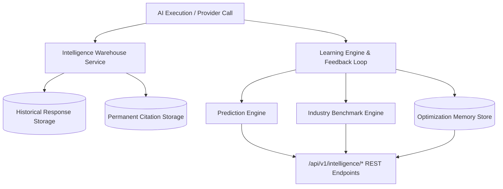

# Enterprise AI Learning & Intelligence Warehouse Architecture Blueprint

## System Architecture

---

## Core Capabilities
- **Immutable Response Ledger**: Stores raw responses, markdown, JSON, token count, cost, and latency.
- **Permanent Citation Storage**: Tracks domain authority, frequency, and categories across Wikipedia, GitHub, Reddit, Medium, and documentation.
- **Predictive Forecasting**: Generates visibility score predictions with upper and lower confidence intervals.
