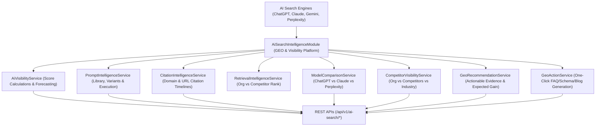

# Enterprise AI Search Visibility & GEO Analytics Architecture Blueprint

## System Architecture

---

## Core Capabilities
- **Advanced GEO Analytics**: Overall AI Visibility scoring (84.5 baseline), citation tracking, retrieval rank analytics, and cross-model performance comparison.
- **Competitor Benchmarking**: Real-time visibility & prompt share comparison (Org vs Peec AI vs Industry Average).
- **One-Click Action Generator**: Transforms AI search insights directly into actionable content (Blog, FAQ, Schema, Landing Pages) executed by the AI Workforce module.
