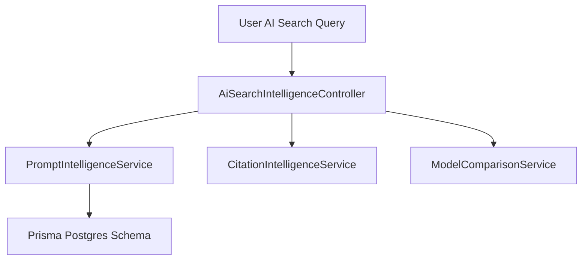

# Enterprise AI Search Intelligence Architecture

## Overview

The AI Search Intelligence platform provides real-time GEO (Generative Engine Optimization) analytics and AI search query inspection across Perplexity, ChatGPT Search, Google Gemini, and Claude.

## Core Functionality

1. **AI Search Query Inspector**: Track prompts, calculate citation rank (#1 to #10), and view model responses.
2. **Foundation Model Comparison Matrix**: Side-by-side comparison of Perplexity Sonar Pro, ChatGPT Search, Gemini 1.5 Pro, and Claude 3.5 Sonnet.
3. **Multi-Region GEO Heatmap**: Track visibility share across North America, Europe, and APAC.
