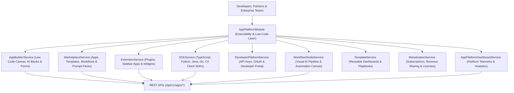

# Enterprise AI App Platform & Extensibility Blueprint

## System Architecture

---

## Core Capabilities
- **Low-Code AI App Builder**: Drag-and-drop visual canvas for assembling custom AI applications, custom forms, dashboards, and automated workflows.
- **AI Marketplace Platform**: Enterprise marketplace for publishing, discovering, installing, and monetizing AI apps, prompt packs, knowledge packs, and integrations.
- **Multi-Language Client SDKs**: Automated SDK generator creating TypeScript, Python, Java, Go, C#, and PHP SDK packages.
