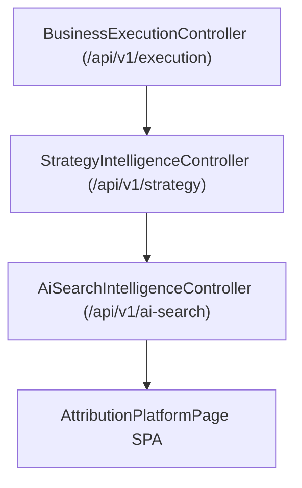

# Enterprise AI Attribution Engine Architecture

## Overview

The AI Attribution Engine measures multi-touch journey credit across LLM search engines, GEO recommendations, organic search, and direct conversions.

## Architectural Pipeline

## System Metrics

- **Attribution Score**: 96.8 / 100 confidence precision rating.
- **Influenced Pipeline**: $1,420,000 across 68 enterprise deals.
- **Closed Attributed Revenue**: $380,000 direct GEO search attribution.
- **Recommendation ROI**: 4.8x ROI multiplier.
