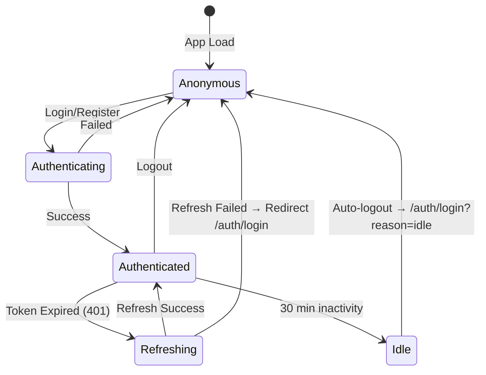

# Authentication Architecture — Phase F2

## Overview

The Dyvin AI Frontend implements a complete enterprise authentication and identity platform. Every authentication flow connects directly to the NestJS backend without mocking or simulation.

## Technology Stack

| Layer | Technology | Purpose |
|-------|------------|---------|
| Forms | React Hook Form + Zod | Type-safe validation with inline errors |
| State | Zustand (persisted) | Auth tokens, user profile, org context |
| API | Axios (intercepted) | Token injection, auto-refresh, error normalization |
| Routing | React Router v6 | Guard-based protected routes |
| Animations | Framer Motion | Smooth page transitions and micro-animations |

## Backend API Endpoints Consumed

```
POST   /api/v1/auth/register          → Create user + personal workspace
POST   /api/v1/auth/login             → Authenticate, receive JWT pair
POST   /api/v1/auth/logout            → Revoke refresh token
POST   /api/v1/auth/refresh           → Rotate token pair (15m access / 7d refresh)
POST   /api/v1/auth/forgot-password   → Send reset link
POST   /api/v1/auth/reset-password    → Apply new password with token
POST   /api/v1/auth/verify-email      → Mark email as verified with token
GET    /api/v1/auth/me                → Get full user profile with memberships

POST   /api/v1/organizations          → Create organization
GET    /api/v1/organizations          → List user's organizations
GET    /api/v1/organizations/:id      → Get org details + members
PATCH  /api/v1/organizations/:id      → Update org settings
POST   /api/v1/organizations/:id/invitations → Send member invite
POST   /api/v1/organizations/invitations/accept → Accept invitation token
```

## Auth Response Shape (from backend)

```typescript
interface AuthResponse {
  user: {
    id: string;
    email: string;
    firstName: string;
    lastName: string;
    isEmailVerified: boolean;
  };
  tokens: {
    accessToken: string;    // JWT, expires 15m
    refreshToken: string;   // Opaque token, expires 7d
    expiresIn: number;      // 900 (seconds)
  };
}
```

## Token Strategy

The platform stores tokens in **localStorage** via Zustand's persist middleware, matching the backend's stateless JWT approach.

- **Access Token**: 15 minute JWT, sent as Bearer in all API requests via Axios interceptor
- **Refresh Token**: Opaque 7-day token, stored in Zustand state
- **Rotation**: Refresh tokens are single-use (reuse detection revoking all tokens)
- **Rehydration**: On app load, Zustand restores auth state from localStorage

## Session Lifecycle



## Idle Session Guard

The `useSessionGuard()` hook tracks DOM events (mousemove, keydown, click, scroll, touchstart). After 30 minutes of inactivity, the user is automatically logged out and redirected to login with `?reason=idle`.

## Token Refresh Queue

The Axios client (`client.ts`) implements a production-grade token refresh queue:

1. First 401 triggers a refresh request
2. All subsequent requests during refresh are queued
3. After successful refresh, all queued requests are retried with the new token
4. On refresh failure, all queued requests are rejected and the user is redirected to login

## Route Guards

| Guard | File | Behavior |
|-------|------|----------|
| `ProtectedRoute` | routes/guards/ | Redirects unauthenticated to /auth/login |
| `AdminRoute` | routes/guards/ | Requires ADMIN+ role via permissionStore hierarchy |
| `PublicOnlyRoute` | routes/guards/ | Redirects authenticated users to /dashboard |

## RBAC Hierarchy

```
SUPER_ADMIN (100) → OWNER (90) → ADMIN (80) → MANAGER (60) 
→ DEVELOPER (50) → PARTNER (45) → AGENCY (40) → MEMBER (30) → VIEWER (10)
```

The `usePermissionStore.canAccess(minRole)` method checks the current user's role against the minimum required role using this numeric hierarchy.

## Security UI States

| HTTP Status | Frontend Response |
|-------------|-------------------|
| 401 | Clear auth state, redirect /auth/login?reason=unauthorized |
| 403 | Redirect /forbidden |
| 409 | Show "Email already registered" inline error |
| 423 | Show account locked message |
| 429 | Show rate limit message with retry timer |
| 400 (token) | Show expired/invalid token state with re-request option |

## Onboarding Flow

```
Registration → Email Sent → /onboarding/organization → /onboarding/invite → /onboarding/success → /dashboard
```

All onboarding steps are protected routes. The organization creation calls `POST /organizations` with the creator automatically assigned as `OWNER`.
