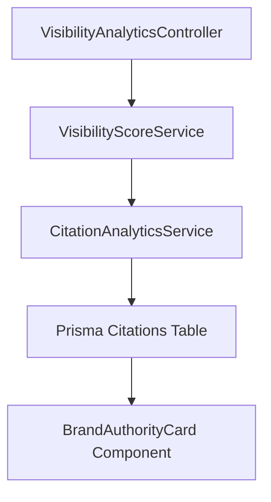

# Enterprise AI Brand Intelligence Architecture

## Executive Overview

The Brand Intelligence module calculates weighted AI brand authority scores (0-100), citation velocity, and sentiment breakdown by discovering citations across foundation AI models.

## Architectural Flow

## Key Metrics

- **Brand Authority Score**: Calculated from domain citation count, authority score of citing domains, and occurrence frequency.
- **Citation Velocity**: Daily citation acquisition rate.
- **Sentiment Breakdown**: Model bias distribution (Positive, Neutral, Negative).
