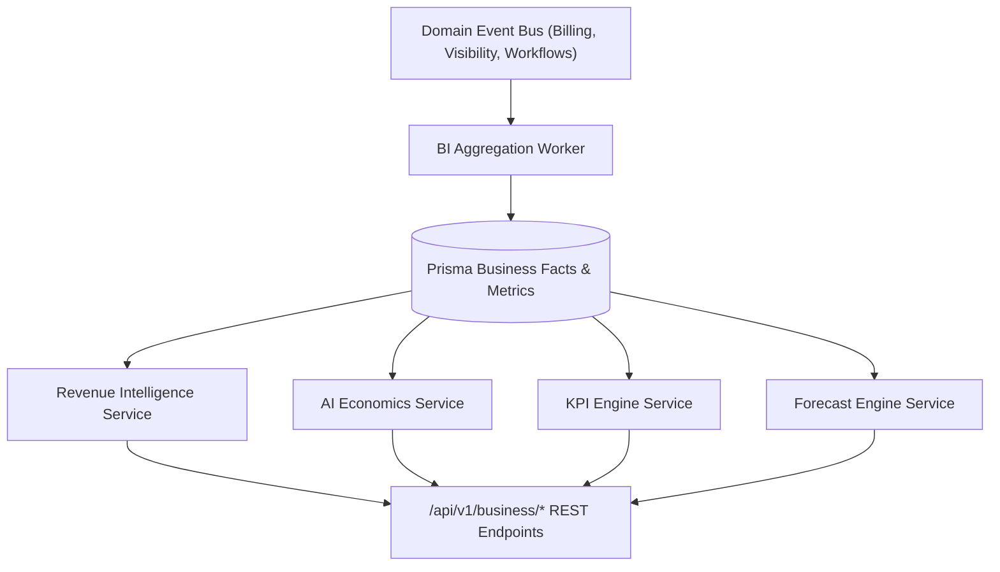

# Enterprise Business Intelligence Platform Architecture Blueprint

## System Architecture

---

## Core Capabilities
- **Executive Dashboards**: Configured for CEO, CTO, COO, CFO, Growth, Product, and Customer roles.
- **Financial Intelligence**: Tracks MRR ($1.2M), ARR ($14.5M), LTV ($48.5k), CAC ($4.2k), and 82.5% Gross Margin.
- **AI Economics**: FinOps accounting per prompt ($0.0024), workspace ($0.38), organization ($2.41), and provider.
