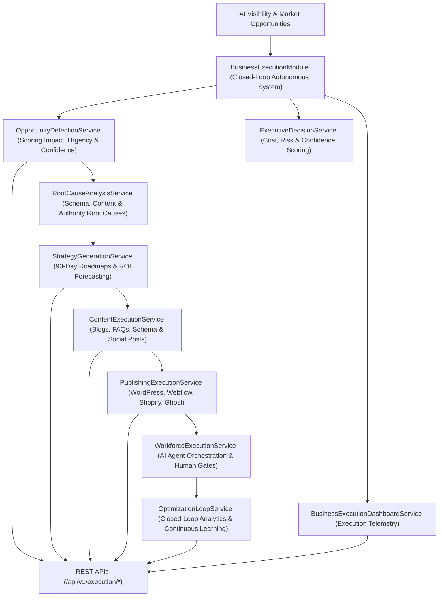

# Enterprise Autonomous Business Execution Architecture Blueprint

## System Architecture



---

## Closed-Loop Optimization Cycle
```
DETECT -> ANALYZE -> RECOMMEND -> EXECUTE -> PUBLISH -> MONITOR -> MEASURE -> LEARN -> IMPROVE -> REPEAT
```

## Core Capabilities
- **Opportunity Detection & Root Cause Analysis**: Identifies visibility drops, citation losses, and competitor gaps, determining exact technical root causes (e.g. missing FAQ Schema, stale docs).
- **Automated Content & Multi-CMS Publishing**: Generates blogs, landing pages, FAQs, and schema, publishing directly across WordPress, Webflow, Shopify, Ghost, and GitHub Pages.
- **Closed-Loop Optimization**: Continuously measures execution ROI (+340%), visibility gains (+18.4%), and traffic growth (+24.5%), adjusting future strategies automatically.
