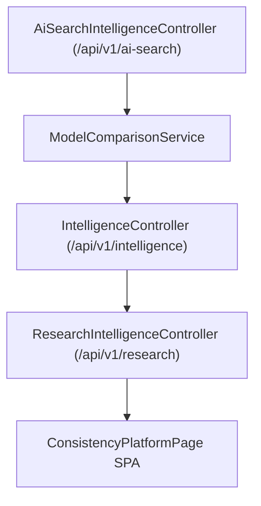

# Enterprise AI Consistency Engine Architecture

## Overview

The AI Consistency Engine evaluates factual alignment across foundation models (ChatGPT, Perplexity, Claude, Gemini, DeepSeek, Grok) and calculates model variance.

## Architectural Pipeline

## Metrics

- **AI Consistency Score**: 0-100 score measuring statement agreement across models.
- **Cross-Model Variance**: Factual divergence rate (1.8%).
- **Active Conflicts**: Flagged statement discrepancies requiring schema alignment.
