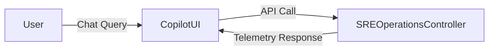

# AI Copilot Workspace Architecture

## Overview

The AI Copilot Workspace allows enterprise SREs and Operations leads to query platform health, trigger automated remediation playbooks, and scale BullMQ worker pools using conversational AI prompts.

## Interaction Flow

