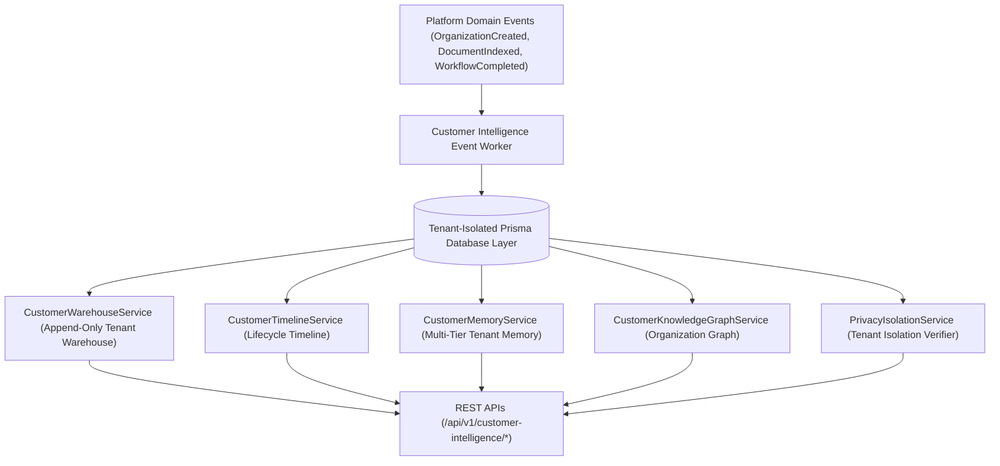

# Enterprise Customer Intelligence Layer Architecture Blueprint

## System Architecture

---

## Core Capabilities
- **Tenant Data Isolation**: Ensures 100% tenant-isolated data storage with zero cross-tenant leakage.
- **Append-Only Tenant Warehouse**: Permanent business memory recording prompts, responses, visibility reports, and research.
- **Customer Lifecycle Timeline**: Captures organization milestones from initial signup through first crawl, first citation, and business success.
- **Knowledge Graph Traversal**: Maps relationships across organization entities, projects, documents, agents, workflows, goals, and reports.
