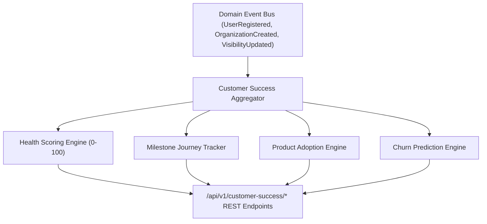

# Enterprise Customer Success Platform Architecture Blueprint

## System Architecture

---

## Core Capabilities
- **0-100 Customer Health Score**: Real-time health calculation across product usage, adoption depth, support tickets, and workspace activity.
- **Milestone Journey Tracking**: Monitors time-to-value across 7 key customer milestones.
- **Churn Prediction**: Forecasts renewal probability (96%) and churn risk (LOW).
