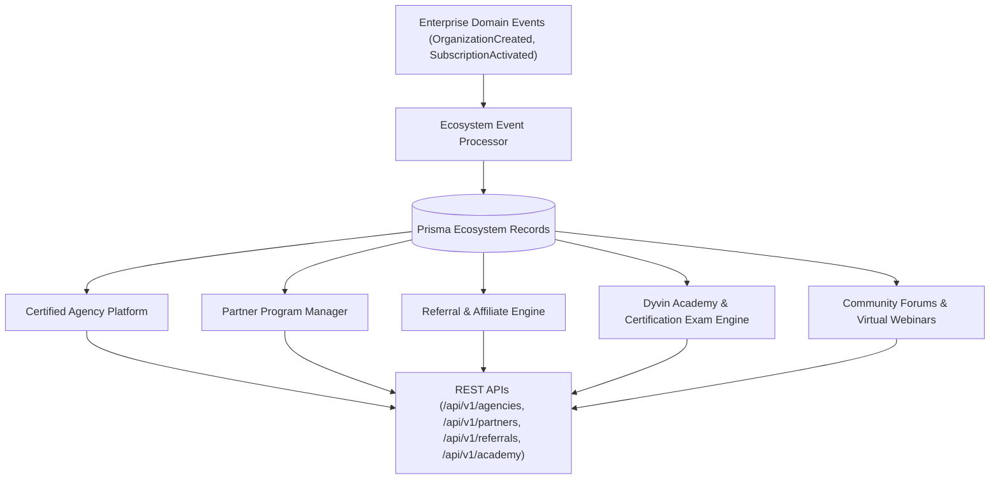

# Enterprise Partner Ecosystem Architecture Blueprint

## System Architecture

---

## Core Capabilities
- **Certified Agency Platform**: Manages agency verification, tiering (Silver, Gold, Platinum), team roles, and portfolio listings.
- **Partner Programs**: Technology, consulting, reseller, OEM, and strategic integration partner management.
- **Referral Engine**: Tracking referral codes, commission payout accounting, and fraud prevention.
- **Learning Academy**: Interactive courses, lab playbooks, exams, and professional certification credentials.
