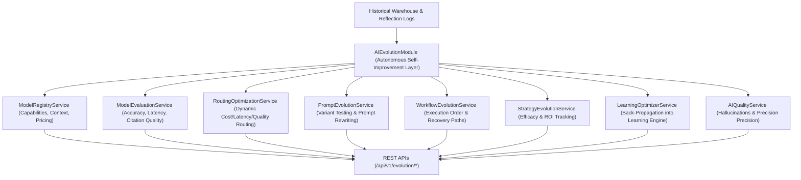

# Enterprise AI Evolution Platform Architecture Blueprint

## System Architecture

---

## Core Capabilities
- **Autonomous Self-Improvement**: Continuously evaluates, optimizes, and evolves prompts, workflows, and model routing strategy without changing public APIs.
- **Dynamic Model Router**: Selects optimal model and provider (e.g. Claude 3.5 Sonnet for complex reasoning, GPT-4o for structured output) while minimizing cost and latency.
- **AI Quality Audit Engine**: Monitors citation precision (98.5%), retrieval accuracy (97.2%), and hallucination suppression (1.2%).
