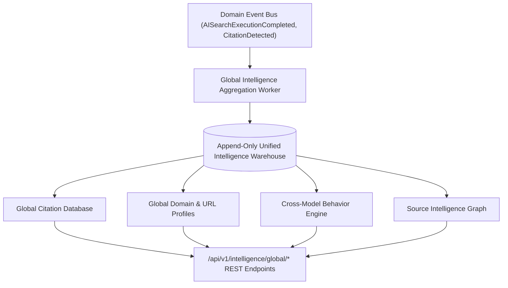

# Global Intelligence Network Architecture Blueprint

## System Architecture

---

## Core Capabilities
- **Append-Only Unified Warehouse**: Single source of truth recording prompts, responses, citations, retrieval scores, and latency without ever overwriting.
- **Global Citation Database**: Tracks frequency, authority, and growth across Wikipedia, GitHub, Stack Overflow, Reddit, and documentation portals.
- **Cross-Model Behavior Engine**: Compares preference heuristics between GPT-4o, Claude 3.5 Sonnet, Gemini 1.5 Pro, and Perplexity.
