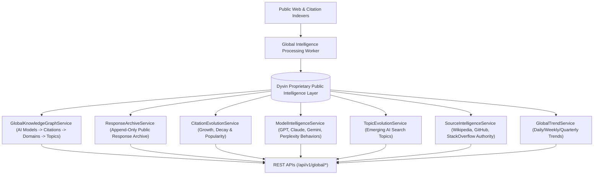

# Dyvin Global Intelligence Layer Architecture Blueprint

## System Architecture

---

## Core Capabilities
- **Proprietary Intelligence Asset**: Accumulates public AI search behavior, model responses, and source citation evolution into a permanent competitive moat.
- **Complete Separation from Customer Layer**: Strictly non-customer public intelligence collected without exposing tenant-private information.
- **Global Knowledge Graph**: Traverses relationships across AI models, prompts, responses, citations, URLs, domains, entities, topics, industries, countries, and knowledge sources.
