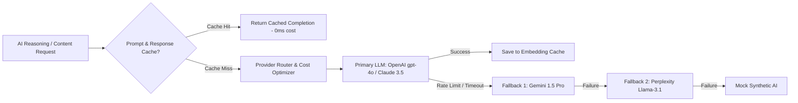
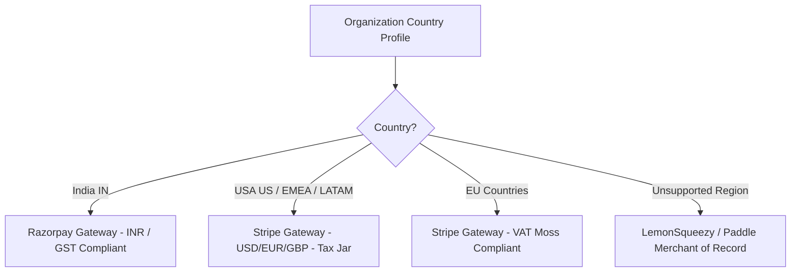

# Dyvin AI — Global Production Architecture Blueprint & Scaling Roadmap

**Architect Role**: Chief Software Architect, Principal Cloud Architect, Principal Security Engineer, Staff SRE, & Distributed Systems Architect  
**Scale Target**: 10 Million Users | Millions of Organizations | Billions of AI Requests | Multi-Region Zero-Downtime  
**Status**: APPROVED GLOBAL PRODUCTION BLUEPRINT

---

## 1. Global Infrastructure Diagram (Text / Mermaid)

```mermaid
graph TD
    Client[Global Clients Web/Mobile] --> Anycast[Cloudflare Enterprise Anycast DNS / WAF]
    
    subgraph Cloudflare Global Edge
        Anycast --> EdgeCache[Cloudflare CDN & Edge KV Cache]
        Anycast --> RateLimit[Edge Rate Limiting & Bot Management]
    end

    EdgeCache -->|Dynamic Requests| GeoRoute[Geo-Routing Load Balancer AWS Route53 Latency]

    subgraph Region 1: US-East (Primary Primary)
        GeoRoute -->|US / Americas| ALB_US[AWS Application Load Balancer]
        ALB_US --> EKS_US[EKS Cluster - API Nodes & BullMQ Workers]
        EKS_US --> Redis_US[AWS ElastiCache Redis Cluster]
        EKS_US --> DB_US[(PostgreSQL Primary - Multi-AZ)]
    end

    subgraph Region 2: EU-West (Europe & UK)
        GeoRoute -->|EMEA| ALB_EU[AWS Application Load Balancer]
        ALB_EU --> EKS_EU[EKS Cluster - API Nodes & BullMQ Workers]
        EKS_EU --> Redis_EU[AWS ElastiCache Redis Cluster]
        EKS_EU --> DB_EU_Replica[(PostgreSQL Read Replica + Local Cache)]
    end

    subgraph Region 3: AP-South (Asia-Pacific)
        GeoRoute -->|APAC| ALB_APAC[AWS Application Load Balancer]
        ALB_APAC --> EKS_APAC[EKS Cluster - API Nodes & BullMQ Workers]
        EKS_APAC --> Redis_APAC[AWS ElastiCache Redis Cluster]
        EKS_APAC --> DB_APAC_Replica[(PostgreSQL Read Replica + Local Cache)]
    end

    DB_US -->|Asynchronous Streaming Replication| DB_EU_Replica
    DB_US -->|Asynchronous Streaming Replication| DB_APAC_Replica

    subgraph Global Object Storage & AI Gateway
        EKS_US & EKS_EU & EKS_APAC --> S3[AWS S3 Multi-Region Access Points]
        EKS_US & EKS_EU & EKS_APAC --> AIGateway[Multi-LLM AI Provider Router with Fallback]
    end
```

---

## 2. Microservice Readiness & Evolution Strategy

### 2.1 Current State: Modular Monolith
The NestJS backend architecture is engineered as a clean Modular Monolith (`backend/src/modules/*`). Domain boundaries are completely encapsulated (`Auth`, `Project`, `Crawler`, `Knowledge`, `AI`, `Reasoning`, `Recommendation`, `Verification`, `Monitoring`, `Generation`, `Billing`, `Report`, `Notification`).

### 2.2 Migration Roadmap
- **Immediate (Phase 1 - 0 to 500k Users)**: Retain Modular Monolith. Decouple background workers into standalone container deployments using BullMQ (`pnpm --filter @dyvin-ai/backend start:prod:worker`).
- **Medium-Term (Phase 2 - 500k to 2M Users)**: Extract heavy async engines (`Crawler Engine`, `AI Reasoning & Auto-Fix Engine`) into independently autoscaled microservices over gRPC / NATS event bus.
- **Long-Term (Phase 3 - 2M to 10M+ Users)**: Fully transition to domain-driven microservices (`Auth Service`, `Organization & Billing Service`, `Intelligence Engine Service`, `Notification Service`) managed under Kubernetes (EKS / GKE) with Istio Service Mesh.

---

## 3. Multi-Region Deployment & Geo-Routing

### 3.1 Regional Footprint
- **US-East (N. Virginia)**: Global Control Plane & Primary Write Database.
- **EU-West (Frankfurt)**: European Data Sovereignty (GDPR) & EMEA Read/Worker Region.
- **AP-South (Mumbai)**: APAC Low-Latency Execution & Payment Processing.
- **ME-Central (UAE)**: Middle East Edge Proxy & Data Processing.
- **AP-Southeast (Sydney)**: Australia & Oceania Edge Proxy.

### 3.2 Geo-Routing & Latency Optimization
- **Cloudflare Anycast DNS**: Routes client requests to nearest edge POP (< 20ms RTT).
- **Latency-Based Routing**: AWS Route 53 directs API traffic to nearest regional Application Load Balancer.

---

## 4. Database Architecture (PostgreSQL & Prisma)

### 4.1 Scaling & Partitioning
- **Horizontal Table Partitioning**: Range-partition high-volume tables (`scans`, `scan_pages`, `analytics_snapshots`, `audit_logs`, `activity_logs`) by `createdAt` (monthly partitions).
- **Tenant Isolation Indexing**: Composite indexes on `[organizationId, createdAt]` across all query targets.

### 4.2 High Availability & Disaster Recovery
- **Multi-AZ Primary**: PostgreSQL 16 Aurora Serverless v2 with automatic failover (< 30s failover).
- **Read Replicas**: Regional read replicas in EU and APAC handling 80% of read traffic (`GET /dashboard`, `GET /analytics`, `GET /reports`).
- **Backup & PITR**: AWS Aurora Continuous Snapshot Backup with 35-day Point-In-Time Recovery (1-second granularity).

---

## 5. Redis Architecture (ElastiCache / Cluster)

### 5.1 Redis Cluster Topology
Separate Redis clusters dedicated per workload:
1. **Cache & Session Cluster**: Fast volatile caching (`LRU` eviction) for user JWT revocation, prompt response cache, and dashboard payloads.
2. **BullMQ Queue Cluster**: Persistent Redis data structures (`AOF` enabled) handling background job streams (`crawler`, `reasoning`, `notification-engine`, `export-engine`).
3. **Rate Limit & Lock Cluster**: Distributed locks using `Redlock` algorithm to prevent concurrent execution races.

---

## 6. AI Infrastructure Optimization



- **Cost Control & Prompt Caching**: Hash input prompts using SHA-256 and store in Redis. Cache hit skips LLM execution completely.
- **Token Budgeting**: Per-organization token quotas enforced via `QuotaEnforcementService`.

---

## 7. Security & Zero Trust Architecture

### 7.1 Defense-in-Depth Matrix
- **Zero Trust Network**: Microservices communicate over Mutual TLS (mTLS) via Istio.
- **Tenant Data Isolation**: Row-Level Security (RLS) policies in PostgreSQL scoping queries strictly to `organizationId`.
- **WAF & DDoS**: Cloudflare Magic Transit & WAF blocking OWASP Top 10, SQLi, XSS, and Layer 7 DDoS.
- **Prompt Injection Protection**: Sanitization layer escaping `<USER_INPUT>` tags in LLM prompt templates.
- **JWT & Token Rotation**: 15-minute access tokens; single-use refresh token rotation with reuse detection revocation.

---

## 8. Global Payment Routing Architecture

### 8.1 Geo-Based Automatic Provider Routing
Payment providers automatically routed based on Organization Country:



### 8.2 Provider Abstraction Layer
- `BasePaymentProvider` abstract interface isolates core billing code from payment vendor SDKs.
- `PaymentProviderRouter` evaluates country and selects `Razorpay`, `Stripe`, or `Fallback` dynamically.

---

## 9. Country & Organization Profile Lifecycle

### 9.1 Two-Stage Onboarding Flow
1. **Stage 1 (Registration)**: Collect `Full Name`, `Email`, `Password`, `Country`, `Terms Acceptance`. Send verification token.
2. **Stage 2 (Post-Email Verification)**: Collect `Organization Name`, `Industry`, `Company Size`, `Website`, `Timezone`, `Language`.

### 9.2 Country Immutability Rules
- Country selection drives **Currency**, **Payment Provider**, **Tax Calculation (GST/VAT)**, and **Regional Compliance**.
- Country is **immutable** post-registration and can only be altered by Organization `OWNER` with compliance audit review.

---

## 10. Recommended Cloud Stack

| Layer | Recommended Production Vendor | Rationale |
|---|---|---|
| **DNS & WAF** | Cloudflare Enterprise | Anycast DNS, DDoS mitigation, WAF, Edge Caching |
| **Compute** | AWS EKS (Kubernetes) | Multi-region container orchestration & HPA |
| **Database** | AWS Aurora PostgreSQL | Multi-AZ auto-scaling, Serverless v2, PITR |
| **Caching & Queues** | AWS ElastiCache for Redis | Managed Redis Cluster with multi-AZ failover |
| **Object Storage** | AWS S3 Multi-Region | S3 Access Points & Lifecycle Archiving |
| **Observability** | Datadog / Grafana Cloud | APM, Distributed Tracing, Prometheus, OpenTelemetry |
| **CI/CD** | GitHub Actions | Automated build, test, Docker push, and ArgoCD deploy |

---

## 11. Future Evolution Roadmap

- **Q3 2026**: Multi-region read replica deployment (US, EU, APAC).
- **Q4 2026**: Transition Crawler & AI Engine to independent EKS worker microservices.
- **Q1 2027**: Zero-Trust Service Mesh (Istio) & Row-Level Security (RLS) enforcement.
