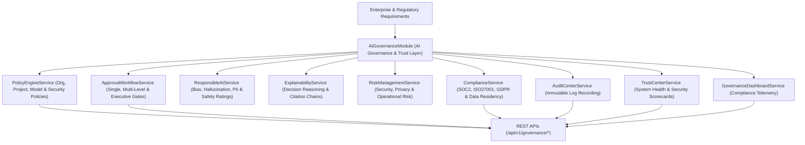

# Enterprise AI Governance & Trust Architecture Blueprint

## System Architecture

---

## Core Capabilities
- **Policy Enforcement**: Centralized AI policy engine enforcing zero PII leakage, execution boundaries, and department-level rules.
- **Approval Workflows & Human Gates**: Multi-tier approval workflows (Executive, Department, Emergency) with conditional delegation.
- **SOC2, ISO27001 & GDPR Compliance**: Built-in compliance engine supporting multi-region data residency, retention policies, and immutable audit trails.
