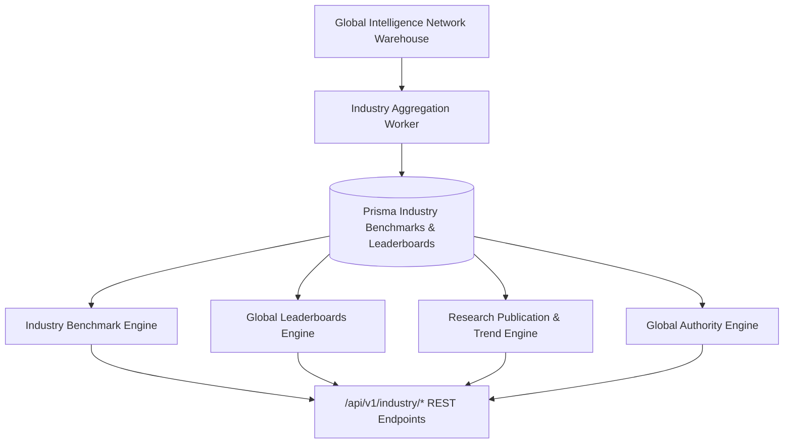

# Enterprise AI Industry Cloud Architecture Blueprint

## System Architecture

---

## Core Capabilities
- **Anonymous Industry Benchmarks**: Calculates median, top 10%, and bottom quartile visibility & citation scores across 24 industry verticals.
- **Global Leaderboards**: Opt-in rankings for top SaaS, FinTech, Healthcare, E-commerce, and Documentation portals.
- **AI Research Publications**: Automated monthly and quarterly AI Search industry reports.
