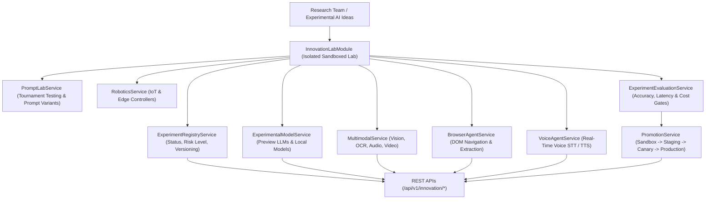

# Enterprise AI Innovation Lab Architecture Blueprint

## System Architecture

---

## Core Capabilities
- **Completely Sandboxed**: Experimental AI features, foundation models, and prompt variants are tested in isolation from production workloads.
- **Next-Gen AI Capabilities**: Supports Multimodal Vision/OCR, Browser Agents, Real-Time Voice STT/TTS, and Industrial Robotics/IoT.
- **Gate Evaluation & Promotion**: Experiments must pass accuracy (≥0.95), latency, and safety evaluation gates before moving through Sandbox → Staging → Canary → Production.
