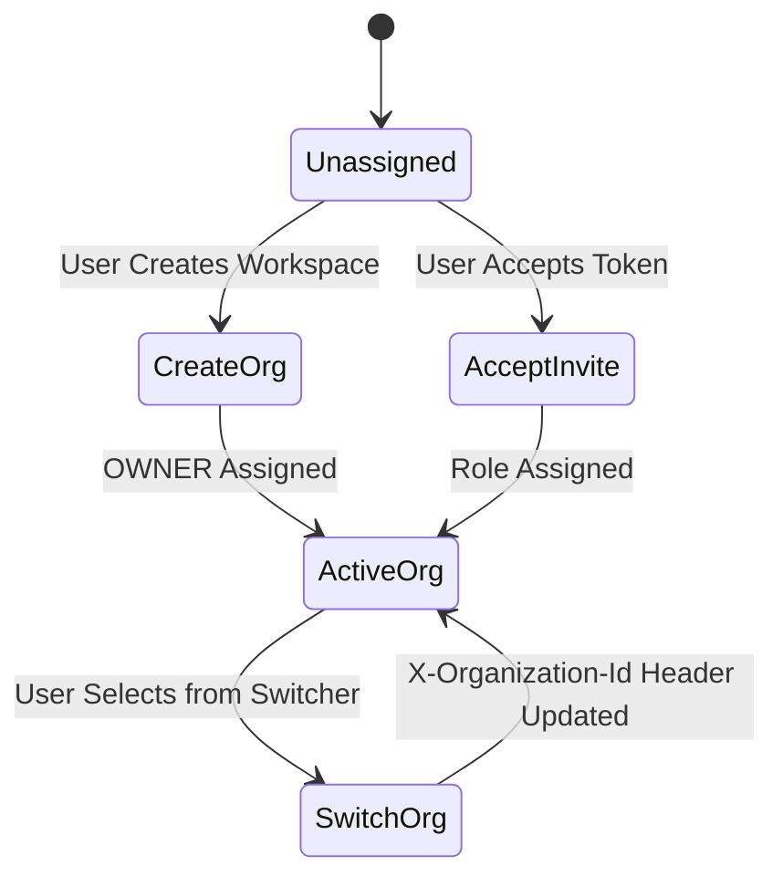

# Organization Architecture — Phase F3

## Overview

The Dyvin AI Organization Platform provides multi-tenant enterprise management, branding, member roster synchronization, and workspace isolation.

## Key Features

- **Multi-Tenant Isolation**: State synchronized via Zustand `orgStore` and persistent HTTP headers (`X-Organization-Id`).
- **Organization CRUD**: Create (`POST /api/v1/organizations`), list, details, and update (`PATCH /api/v1/organizations/:id`).
- **Member Roster Management**: Roles (OWNER, ADMIN, MANAGER, MEMBER, VIEWER), token-based invitations (`POST /api/v1/organizations/:id/invitations`), and instant acceptance.
- **Brand Customization**: Logo URL, custom slug, metadata, and timezone configuration.

## Organization State Machine

