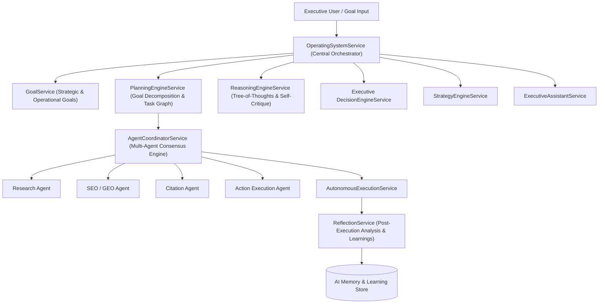

# Dyvin AI 2.0 Autonomous AI Operating System Architecture Blueprint

## System Architecture

---

## Core Capabilities
- **Central Orchestration**: Coordinates all 35+ backend business modules into an autonomous execution layer.
- **Planner Engine**: Decomposes high-level goals into multi-task DAG execution graphs with risk scoring and duration estimates.
- **Tree-of-Thoughts Reasoning**: Evaluates alternative execution paths and self-critiques choices prior to execution.
- **Reflection Engine**: Conducts post-execution audits to log learnings and continuously improve agent strategy.
