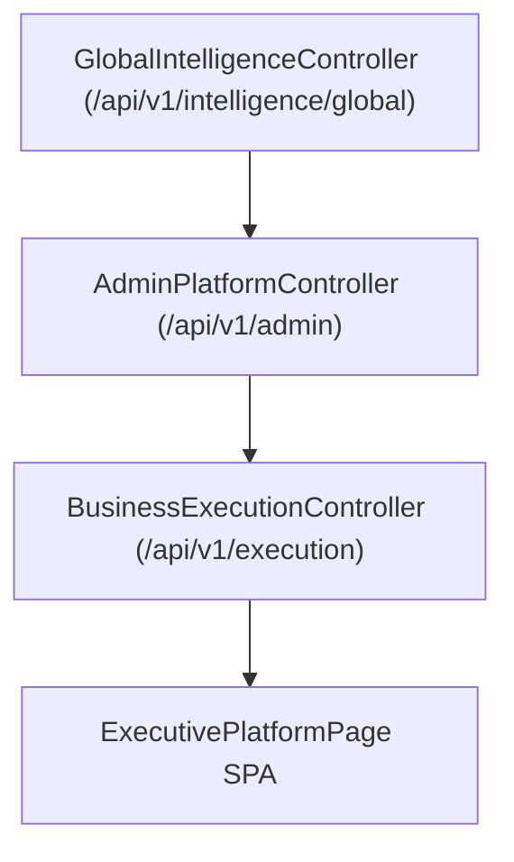

# Phase F12 — Enterprise Executive Intelligence Architecture

## Overview

The Executive Intelligence & Global Command Center provides executive oversight across Unified AI Brand Scores, LLM decision provenance explainability, and multi-region infrastructure telemetry.

## Architectural Pipeline

## System Metrics

- **Unified AI Brand Score**: 97.6 / 100 market leadership rating.
- **Global Platform Health**: 99.98% SLA uptime.
- **Warehouse Executions**: 8,500,000 permanent ledger records.
- **Strategic Velocity**: +34.2% quarter-over-quarter expansion.
