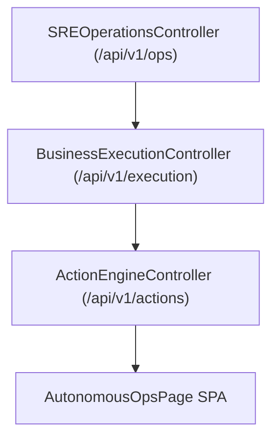

# Phase F13 — Autonomous Operations & Copilot Architecture

## Overview

Phase F13 provides autonomous SRE operational health monitoring, interactive AI Copilot query resolution, automated playbook remediation, and predictive capacity forecasting.

## Architectural Pipeline

## System Metrics

- **System SLA Availability**: 99.98% uptime SLA.
- **Active Workers**: 12 BullMQ container nodes.
- **Unresolved Incidents**: 0 critical incidents.
- **FinOps Monthly Cost**: $4,250 with 94% prompt cache hit rate.
