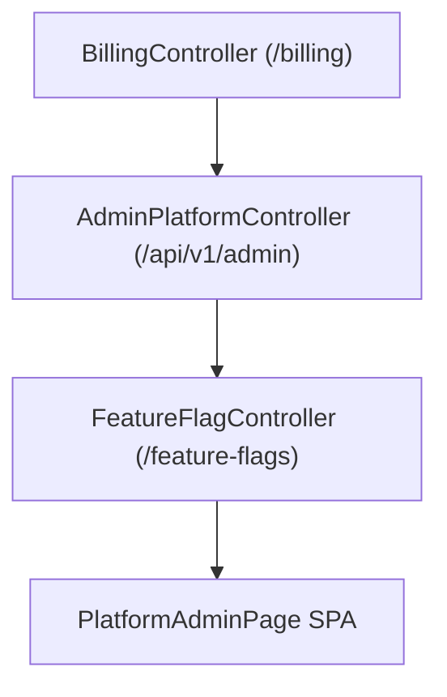

# Phase F14 — Multi-Tenant Administration & Billing Architecture

## Overview

Phase F14 provides enterprise multi-tenant administration, subscription billing with Stripe/Razorpay, feature flag governance, support center operations, and admin audit trail.

## Architectural Pipeline

## Backend Controllers

- **BillingController**: Plans, subscriptions, usage, invoices, payments, webhooks.
- **AdminPlatformController**: Tenants, quota overrides, support tickets, licenses, health, usage, audit, impersonation.
- **FeatureFlagController**: CRUD flags, evaluate, rollout strategies, kill switch.
