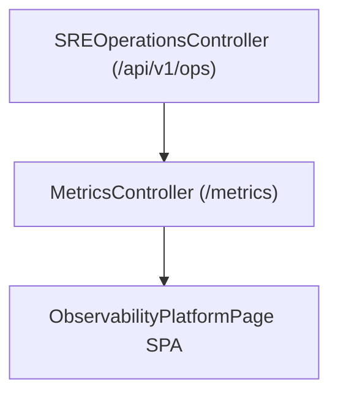

# Phase F15 — Observability & Reliability Engineering Architecture

## Overview

Phase F15 provides enterprise-grade observability, Prometheus/Grafana metric streams, distributed OpenTelemetry tracing, SLO error budget tracking, and dependency gateway monitoring.

## Architectural Pipeline

## Core Observability Metrics

- **Platform SLA Uptime**: 99.98% SLA target.
- **SLO Error Budget**: 98.2% remaining budget.
- **Prometheus Metric Export**: `text/plain; version=0.0.4` at `/metrics`.
- **Dependencies Monitored**: AWS Aurora, ElastiCache Redis, OpenAI, Anthropic, Google Gemini.
