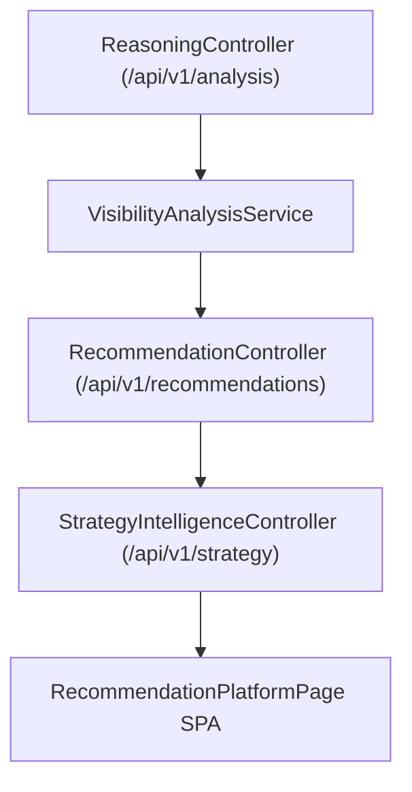

# Enterprise AI Recommendation Engine Architecture

## Overview

The Recommendation Intelligence Engine transforms AI search visibility analysis, knowledge gap findings, and citation authority metrics into prioritized, actionable business recommendations.

## Pipeline Architecture

## Core Components

- **Score & ROI Estimator**: Calculates predicted score increases (+18.5 pts) and monthly revenue impacts.
- **Evidence Provenance Chain**: Links recommendations directly to source URL snippets and confidence scores.
- **Strategy Execution Planner**: Generates ordered 3-step action roadmaps with prerequisite handling.
