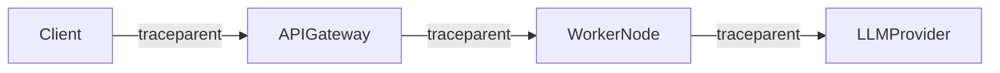

# Distributed Tracing Architecture

## OpenTelemetry Tracing

Distributed tracing tracks end-to-end request flows across frontend SPA API calls, NestJS backend controllers, BullMQ worker nodes, and foundation model APIs.

