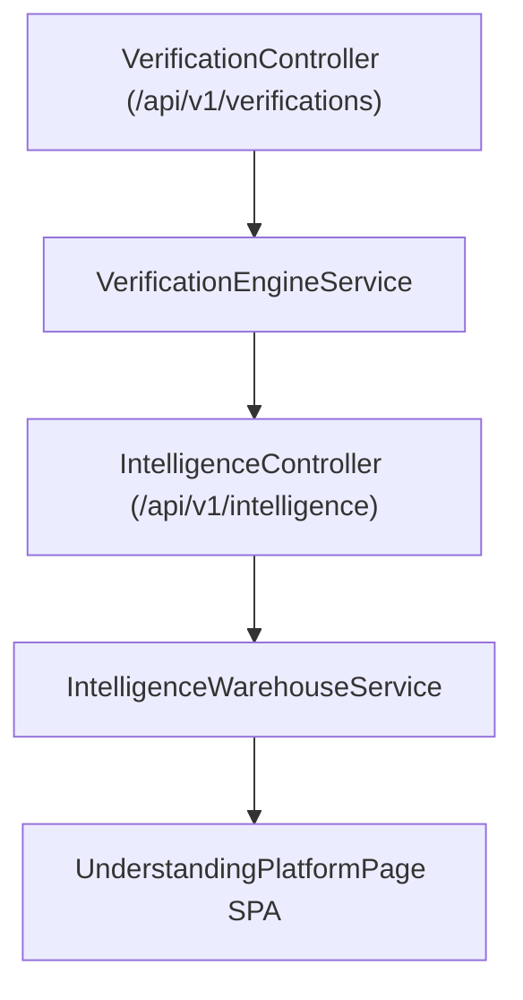

# Enterprise AI Understanding Engine Architecture

## Overview

The AI Understanding Engine measures semantic comprehension, fact verification alignment, and knowledge gap resolution across foundation models.

## Architectural Pipeline

## System Metrics

- **AI Understanding Index**: 0-100 score quantifying accuracy of model summaries.
- **Hallucination Detection Rate**: Percentage of flagged factual drifts.
- **Cross-Model Latency**: Response execution speeds (95 ms - 140 ms).
