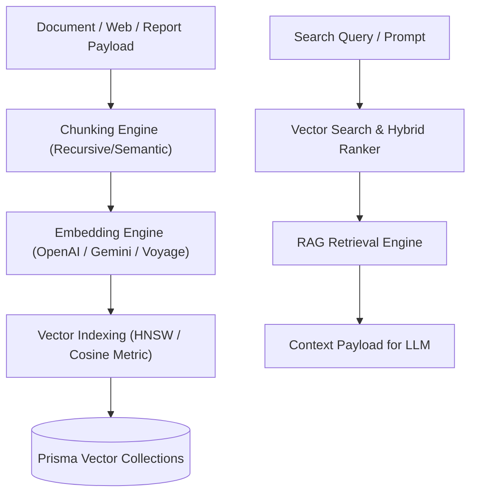

# Enterprise Vector Intelligence Platform Architecture Blueprint

## System Architecture

---

## Core Infrastructure Capabilities
- **Multi-Provider Embeddings**: Dynamic routing across OpenAI (`1536-dim`), Gemini (`768-dim`), Voyage (`1024-dim`), and Cohere.
- **Hybrid Search**: Combines BM25 keyword matching with vector semantic similarity.
- **RAG Context Retrieval**: Formats top-K chunks for agent memory and prompt injection.
