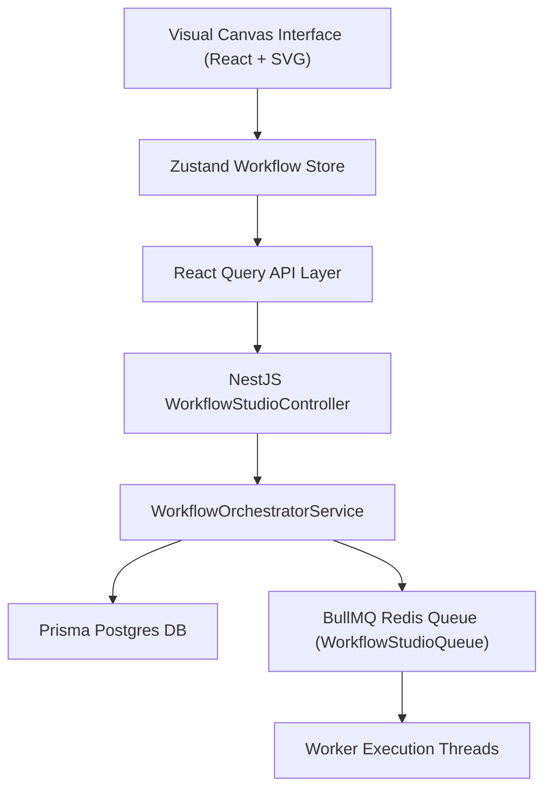

# Dyvin AI Enterprise Workflow Studio Architecture

## Executive Summary

The Dyvin AI Workflow Studio is an enterprise visual automation and AI orchestration platform. It enables organizations to build, execute, monitor, and scale multi-node AI pipelines seamlessly integrated with NestJS backend modules (`WorkflowStudioModule`, `ActionEngineModule`, `IntegrationHubModule`, `ObservabilityModule`).

## Core Architectural Pillars

### Key Subsystems
1. **Interactive Drag-and-Drop Canvas**: High-performance SVG & HTML5 canvas renderer supporting zoom, pan, grid snap, port-to-port edge creation, and cycle detection.
2. **Node Palette**: 20+ backend-backed node types (Triggers, Search, Reasoning, Generation, Verification, Recommendation, Knowledge Graph, Notifications, Databases).
3. **Execution Console**: Live log streaming, historical execution records, and real-time BullMQ queue latency monitoring.
4. **Integration Hub**: Deep integration with CRM, CMS, and Webhook providers.
