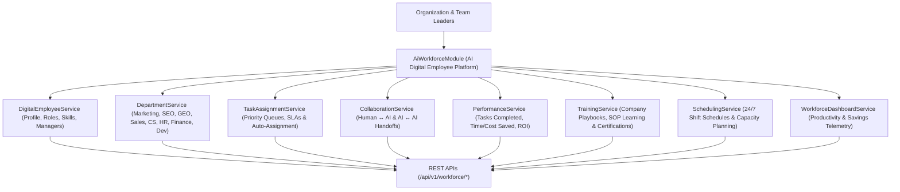

# Enterprise Autonomous AI Workforce Architecture Blueprint

## System Architecture

---

## Core Capabilities
- **Digital Employee Registry**: Hire, onboard, train, assign, and manage AI Digital Employees across 11 specialized business departments.
- **Human-AI & AI-AI Collaboration**: Facilitates seamless task handoffs, workspace mentions, review approvals, and shared comments.
- **Enterprise Scheduling & Training**: Supports 24/7 continuous shift scheduling, capacity planning, company SOP playbook training, and skill certifications.
