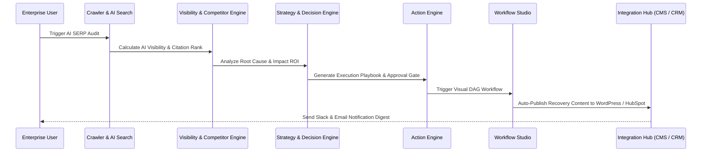

# Dyvin AI Service Dependency Graph & Architecture Diagrams

## 1. Platform Architecture Overview

```mermaid
graph TD
    Client["Enterprise Client / Developer / SDK"] --> Gateway["API Gateway & Throttler"]
    Gateway --> AuthModule["Auth & Organization Isolation"]
    
    subgraph Core Intelligence Engine
        Crawler["Crawler & Knowledge Graph"]
        AISearch["AI Search Intelligence"]
        Citation["Citation Intelligence"]
        Retrieval["Retrieval Intelligence"]
        Visibility["AI Visibility Analytics"]
        Competitor["Competitor Intelligence"]
        Research["Research Intelligence"]
    end
    
    subgraph Decision & Action Layer
        Strategy["Strategy & Decision Engine"]
        ActionEngine["Action Engine"]
        WorkflowStudio["Workflow Studio Orchestrator"]
    end
    
    subgraph Ecosystem & Extensibility
        IntegrationHub["Integration Hub (22 SaaS)"]
        DevPlatform["Developer Platform (OAuth2 / Keys)"]
        AgentMarketplace["AI Agent Ecosystem & Marketplace"]
    end
    
    subgraph Enterprise Infrastructure
        AdminPlatform["Admin Control Plane"]
        PlatformSecurity["Security, SOC2 & Disaster Recovery"]
        Billing["Billing & Quota Engine"]
        BullMQ["BullMQ Queues & Workers"]
    end
    
    AuthModule --> Core Intelligence Engine
    Core Intelligence Engine --> Decision & Action Layer
    Decision & Action Layer --> Ecosystem & Extensibility
    Ecosystem & Extensibility --> Enterprise Infrastructure
    Decision & Action Layer --> BullMQ
```

---

## 2. Event Queue Dispatch Architecture


