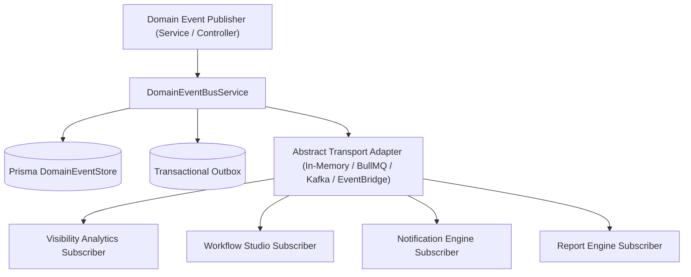

# Dyvin AI Enterprise Domain Event Bus Architecture

## 1. Event-Driven Architecture Overview

The Domain Event Bus (`backend/src/core/events/`) provides asynchronous, non-blocking event-driven communication across all 30 Dyvin AI backend modules.

---

## 2. Core Features
- **Correlation & Causation Tracking**: Every event carries `correlationId` and optional `causationId`.
- **Transactional Outbox**: Prevents dual-write issues between database mutations and event messaging.
- **Event Replay & Time Travel**: Replay historical events on demand for auditing or debugging.
- **Transport Abstraction**: Plug-and-play support for In-Memory, BullMQ, Redis Streams, NATS, RabbitMQ, Kafka, and AWS EventBridge.
