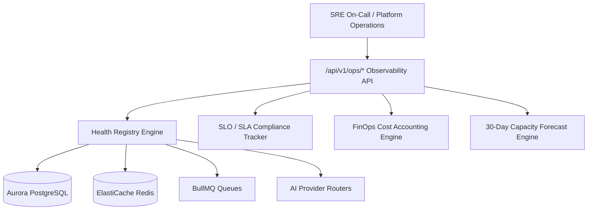

# Real-Time SRE Operations Dashboard Specification

## 1. Executive Dashboard Architecture

The Dyvin AI Real-Time Operations Platform aggregates metrics across all 30 backend modules via Grafana, OpenTelemetry, Datadog, and Prometheus.

---

## 2. Dashboard Widgets & Live Metric Endpoints
- **Global Platform Status**: `GET /api/v1/ops/status`
- **Real-Time Health Registry**: `GET /api/v1/ops/health`
- **SLO Compliance Tracker**: `GET /api/v1/ops/slo`
- **FinOps Provider Cost Breakdown**: `GET /api/v1/ops/costs`
- **30-Day Capacity Forecast**: `GET /api/v1/ops/capacity`
